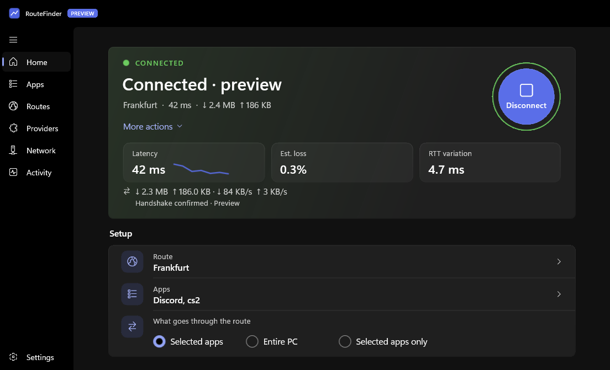
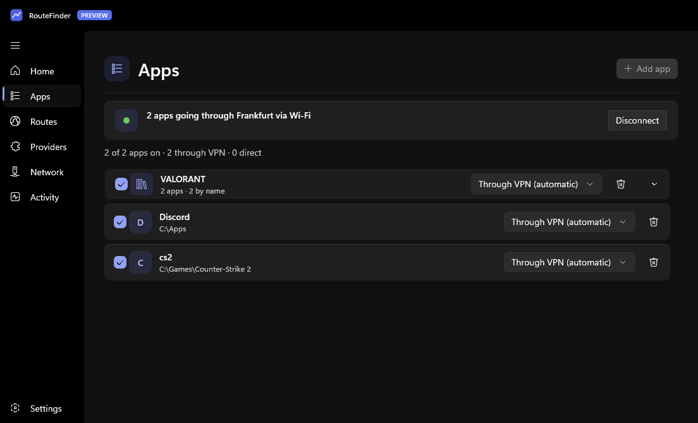
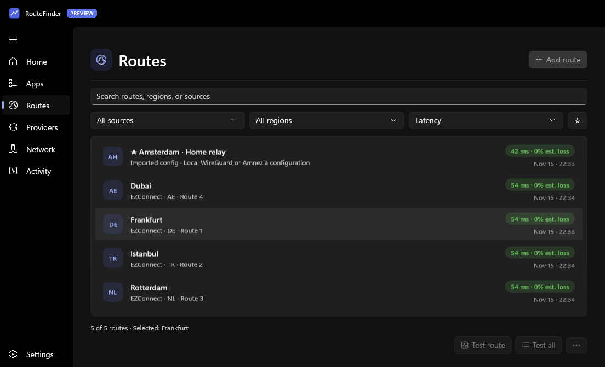
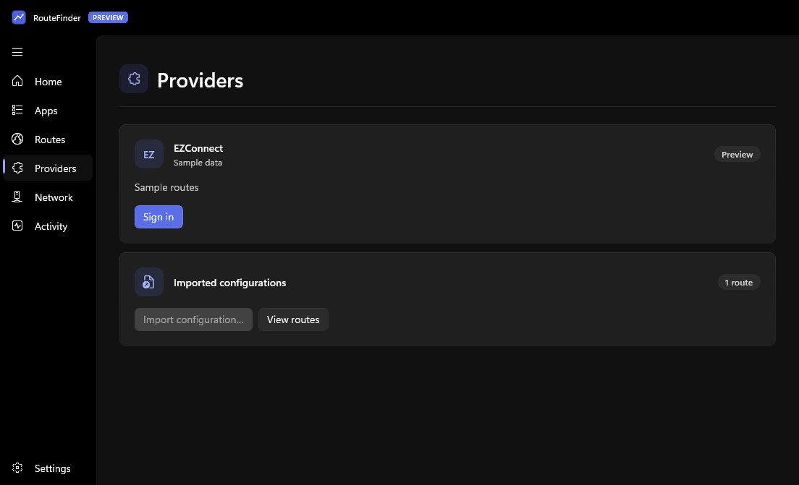
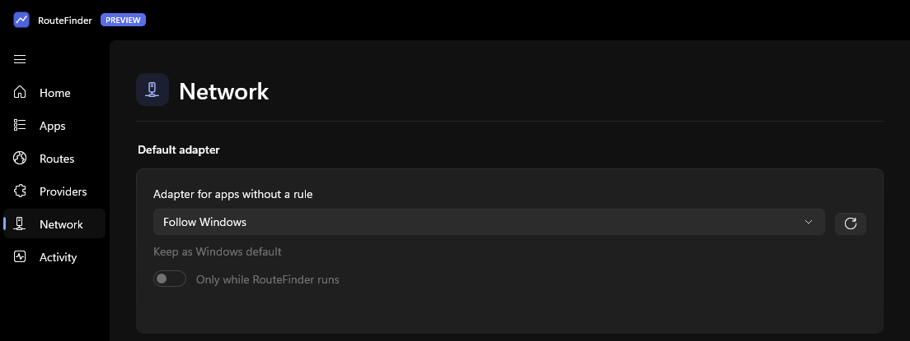
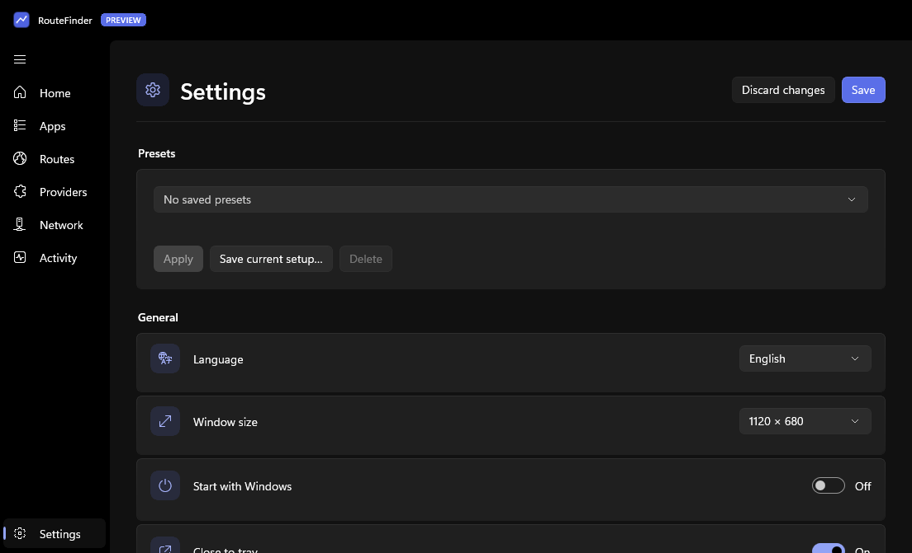
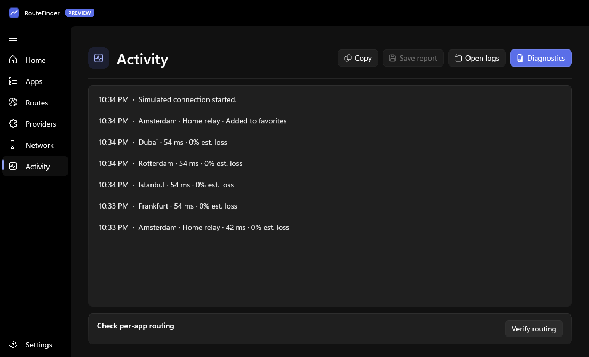
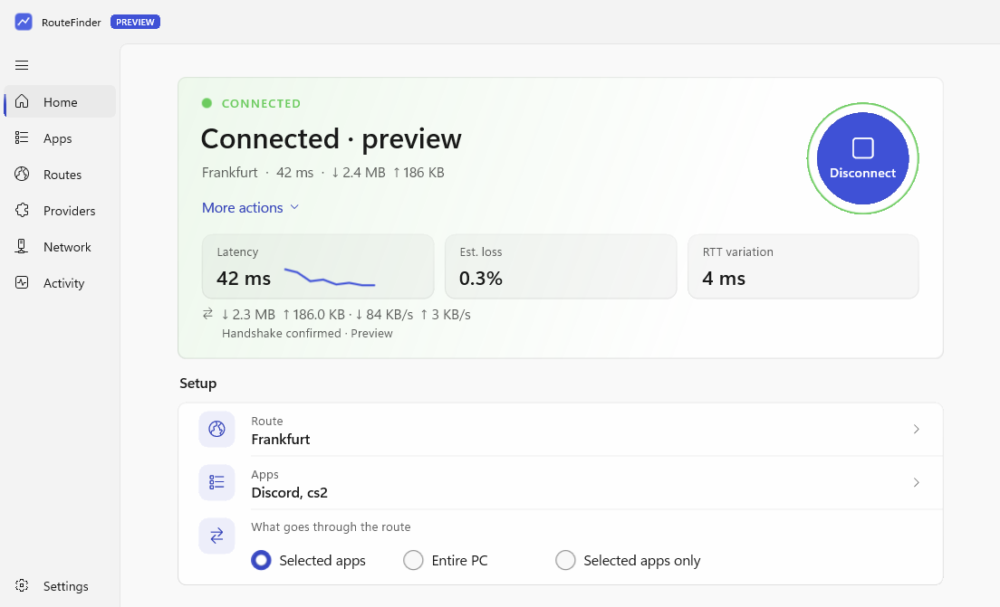

# RouteFinder

**Choose which apps on your Windows PC go through a VPN, and which stay on your normal connection.**

[**Download the latest installer (Windows x64)**](https://github.com/AMIRSRAD/RouteFinder/releases/latest/download/RouteFinderSetup.exe) · [All releases](https://github.com/AMIRSRAD/RouteFinder/releases)

This page has three parts:

1. [**Using RouteFinder**](#part-1--using-routefinder): what it does, how to install it, and how to use it. No technical knowledge needed.
2. [**How it works**](#part-2--how-it-works): a technical explanation of routing, DNS, storage and the WireSock SDK.
3. [**Getting started and building**](#part-3--getting-started-and-building): build, test and package RouteFinder yourself.

---

# Part 1 · Using RouteFinder

## What is RouteFinder?

A VPN normally sends *everything* your PC does through another country or network. That is often too much: games get slower, banking sites get suspicious, and local devices stop working.

RouteFinder lets you decide **app by app**. Put Discord or Telegram through the VPN while your browser, your game or your downloads keep using your normal internet connection. If you have two connections (for example Wi-Fi and a network cable), you can also say which one each app uses.



**What you can do with it**

- Send only the apps you pick through a VPN, and leave everything else alone.
- Send an app **directly** over a specific connection, for example a game over your cable instead of Wi-Fi.
- Switch an app on or off with a tick box, without removing it.
- Add a whole game with one click: its launcher, anti-cheat and helper programs are grouped together.
- Use VPN routes from an **EZConnect** account, or import your own **WireGuard** or **Amnezia** configuration file.
- Compare routes by speed before you connect.
- Stay connected when another VPN program is also installed.
- Fix apps that can't reach a service because your network filters websites.
- Start in the tray when Windows starts, if you want.

## What you need

| You need | Why |
| --- | --- |
| Windows 10 (version 1809 or later) or Windows 11, 64-bit | RouteFinder is a Windows app. |
| [WireSock Secure Connect](https://www.wiresock.net/) installed | RouteFinder uses its engine to create the VPN connection. It is a separate free download. |
| A VPN to use: an EZConnect account, or a WireGuard/Amnezia `.conf` file | This is where your traffic goes. RouteFinder does not provide a VPN. |
| Administrator rights | Needed to create network connections and rules. RouteFinder asks for them when it starts. |

## Install

1. Install **WireSock Secure Connect** first, if you don't have it.
2. Download **RouteFinderSetup.exe** from the [latest release](https://github.com/AMIRSRAD/RouteFinder/releases/latest) and run it. Windows asks for administrator permission.
3. On the last page you can tick **Start RouteFinder when Windows starts**. It is off by default and you can change it later in Settings.
4. Open RouteFinder from the Start menu or the desktop shortcut.

To update later, open **Settings → Maintenance → Check for updates**. RouteFinder downloads the official installer, checks that it is genuine, closes itself and runs it. Stop any active connection first. To uninstall, use **Installed apps** in Windows Settings.

## Your first connection

1. **Add a route.** Open **Providers** and sign in to EZConnect, or open **Routes → Add route** and import a WireGuard/Amnezia file. Your routes appear in one list.
2. **Test (optional).** On **Routes**, pick a route and press **Test route**, or **Test all** to see which is fastest.
3. **Add apps.** Open **Apps → Add app** and pick the programs to send through the VPN. A running program can be picked from a list. Games from EZConnect's catalog are added as one group.
4. **Choose how each app connects** with the menu beside it (see below).
5. Press **Connect** on **Home**. Restart apps that were already running, so they open a fresh connection.



**The menu beside each app**

- **Through VPN** uses the route you selected. **Through VPN via Wi-Fi / Ethernet** also says which of your connections carries the VPN.
- **Direct · Wi-Fi / Ethernet** keeps the app **off** the VPN and always uses that connection.

On **Home**, **What goes through the route** can also be set to **Entire PC** (everything uses the VPN) or **Selected apps only** (the apps you picked use it and every other app is blocked from the network while connected).

## A tour of the app

| Page | What it is for |
| --- | --- |
| **Home** | The connection status, speed and the one big Connect button. |
| **Apps** | Your apps, switches, and how each one connects. |
| **Routes** | All your routes with search, filters and speed tests. |
| **Providers** | Your EZConnect account and imported configuration files. |
| **Network** | Your network connections, the default connection, and DNS. |
| **Activity** | What RouteFinder is doing, diagnostics, and a check that proves which apps use the VPN. |
| **Settings** | Presets and options. |

| Routes | Providers |
| --- | --- |
|  |  |

| Network | Settings |
| --- | --- |
|  |  |



RouteFinder follows your Windows light or dark theme:



*The screenshots come from RouteFinder's preview mode, which uses sample routes and a simulated connection.*

## Useful options

All of these are in **Settings** unless noted. Changes to the connection are applied automatically while you are connected.

| Option | What it does |
| --- | --- |
| **Presets** | Save your whole setup (route, apps, how each connects, options) under a name, and load it later. |
| **Close to tray** (on) | Closing the window keeps RouteFinder running next to the clock. Use **Exit** in the tray menu to quit. |
| **Start with Windows** (off) | Starts RouteFinder in the tray when you sign in, without a permission prompt each time. |
| **Secure DNS while connected** (on) | Stops filtered networks from sending your apps to the wrong address (see Troubleshooting). |
| **Kill switch** (off) | While connected, blocks traffic that would bypass the VPN. |
| **Allow local network** (off) | Keeps printers and other devices on your network reachable. |
| **Pause F-Secure while RouteFinder runs** (off) | Turns off F-Secure's services while RouteFinder runs and turns them back on when it closes. |
| **Detailed logging** (off) | Writes a detailed log to help find problems. Open it from **Activity → Open logs**. |
| **Network → Default adapter** | Pick which connection apps without a rule use. **Keep as Windows default** keeps that choice after RouteFinder closes. |

## Troubleshooting

**An app (for example a game launcher) shows a blank window.** Update to the latest version. Older versions applied rules to an app's traffic inside your PC. If it still happens, turn on **Detailed logging**, try again, and open an issue with the log.

**An app such as Discord can't connect even though the VPN is connected.** Some networks filter websites and answer with a "blocked" address. Turn on **Settings → Secure DNS while connected**, then restart the app. If your security software (for example F-Secure) filters all DNS, try **Pause F-Secure while RouteFinder runs**.

**It won't connect, or nothing works afterwards.** Open **Activity**. Press **Disconnect** and then **Connect** again. If it says cleanup is pending, press **Retry cleanup**. Make sure WireSock Secure Connect is installed and that you opened RouteFinder as administrator.

**Another VPN program is installed.** RouteFinder keeps its own connection and your VPN apps on your real connection so they don't end up inside the other VPN. For the most reliable result, switch the other VPN off while using RouteFinder.

**How do I check that an app really uses the VPN?** Use **Activity → Verify routing**: it compares the public IP address seen by two browsers.

**Where are my logs?** With **Detailed logging** on, in `%LOCALAPPDATA%\RouteFinder\logs`, or press **Activity → Open logs**. **Activity → Save report** saves a support report you can attach to an issue.

## Your privacy

- Your routes, presets, favorites, test results and settings are encrypted for your Windows user and stored on your PC in `%LOCALAPPDATA%\RouteFinder`.
- If you choose to stay signed in to EZConnect, an encrypted token is kept so you don't have to sign in again. Signing out removes it.
- RouteFinder contacts GitHub to check for updates, your VPN provider to connect, and public DNS-over-HTTPS servers (Cloudflare and Google) when Secure DNS is on. It contains no ads or analytics.
- No VPN driver, key or account is bundled. RouteFinder uses the WireSock you install.

---

# Part 2 · How it works

## Overview

RouteFinder is a WinUI 3 (Windows App SDK 1.8, .NET 8, x64) desktop app. It does not implement a VPN itself:

- **WireSock SDK** (`wgbooster.dll`, loaded from the installed WireSock Secure Connect at `sdk\wgbooster.dll`) creates and runs the WireGuard or Amnezia tunnel. In *transparent mode* it captures the traffic of the listed executables on the physical adapter it reaches the server through. In *virtual adapter mode* it creates a virtual adapter. It also provides the *network lock* used for "Selected apps only" and the kill switch.
- **Windows Filtering Platform (WFP) connection policies** pin individual apps to a chosen adapter.
- **Windows routing, DNS and Task Scheduler** are used for the default adapter, secure DNS and Start with Windows.

The solution has four projects:

| Project | Role |
| --- | --- |
| `RouteFinder.Core` | WireSock binding (`WireSockTunnel`), profile parsing and validation (`TunnelProfile`), the uplink host route (`TunnelUplink`), WFP rules (`DirectAppRouting`), the diagnostic log. |
| `RouteFinder.Service` | EZConnect HTTP client and models. |
| `RouteFinder.App` | Connection session, encrypted profile store, route tests, update check, and the classic WinForms shell. Parts are shared with the WinUI project. |
| `RouteFinder.WinUI` | The current UI and all window logic (one `MainWindow` split across many files). |

## Apps and groups

Each app is one entry with a tick box and one menu: *Through VPN (automatic)*, *Through VPN via <adapter>*, or *Direct · <adapter>*. One tunnel runs at a time, so the adapter chosen for "Through VPN" applies to every Through VPN app.

A catalog game from EZConnect becomes one **group**: its members are paths in the app list, and executables that were not found stay as pending names. Pending names are given to WireSock by name (matched by process name, as EZConnect does). Names used by many programs, such as `Update.exe`, only match inside the group's own folders and are never passed by name. Detection uses `QueryFullProcessImageName` (works for protected processes), searches near known files and the install folders from the uninstall registry, and is throttled.

**Home → What goes through the route**:

- **Selected apps**: only the Through VPN apps use the tunnel.
- **Entire PC**: all traffic uses the tunnel. WireSock's transparent mode only captures traffic on the adapter it reaches the server through, so while connecting or connected every app is pinned to that adapter. Direct apps and the default adapter pause.
- **Selected apps only**: the Through VPN apps are pinned to the tunnel's adapter and WireSock's network lock blocks other apps.

Changes made while connected (apps, route, adapter, scope, connection settings) are detected by a setup signature and applied by an automatic reconnect after a short pause.

## Adapter rules (WFP)

Direct apps and Through VPN pins are enforced with temporary WFP connection policies (`FwpmConnectionPolicyAdd0`) whose next hop is an interface LUID, in a dynamic session so Windows removes them if RouteFinder exits. They need `netsh interface ipvX set global routepolicies=enabled store=active`, detected locale-independently by comparing the settings block before and after. A global semaphore allows only one RouteFinder process to own the rules. Explicit app rules have weight 1 and the optional catch-all has weight 0. Rules are applied automatically, replaced without toggling the route-policy setting, and re-applied when adapters change.

**Internet addresses only.** One rule per range: seven IPv4 ranges (the internet space minus loopback, private, link-local, CGNAT, multicast and reserved space) plus `2000::/3`. Windows allows one address condition per rule (a second one fails with `0x8032002A`), hence one rule per range. Traffic inside the PC, the LAN, link-local and multicast always follows Windows, so a pinned launcher such as Riot Client can still reach its own local service. If a Windows build rejects this form, the rules fall back to loopback-excluded rules and say so in the log.

**Tunnel pins.** RouteFinder.exe (which sends the encrypted tunnel traffic) and the Through VPN apps are pinned to the tunnel's adapter whenever Windows would send them elsewhere: a default adapter is set, another VPN holds the default route, or the route's adapter is not the one Windows prefers. This is not possible in virtual adapter mode. If the chosen uplink has no gateway, a working physical adapter is used.

## Default adapter

**Network → Default adapter** is set the Windows way: the chosen adapter's IPv4 and IPv6 interface metric is lowered to 1 so Windows prefers it for every app and service, with no rule on other apps. If it is already Windows' choice nothing changes. The original metrics are saved to `%LOCALAPPDATA%\RouteFinder\metric-restore.txt` and restored on **Follow Windows**, on exit, at session end, and at the next start after a crash. **Keep as Windows default** skips the restore on exit. If another VPN holds the default route with split routes (`0.0.0.0/1` and `128.0.0.0/1`), which no metric can outrank, a catch-all WFP rule is used instead.

## Other VPNs on the same PC

An adapter counts as another VPN if it is a tunnel/virtual type or its name or description looks like Wintun, TAP, WireGuard, OpenVPN or similar (never WireSock). When one holds the best route, "automatic" would nest RouteFinder's tunnel inside it, so RouteFinder uses the best physical adapter (Ethernet first, then Wi-Fi) as the tunnel's uplink, adds the host route to the VPN server through it, and pins itself and the Through VPN apps there. That adapter is also excluded from the adapter menus. If the VPN has a kill switch that blocks everything else, RouteFinder cannot override it.

## DNS

Windows resolves names for every app in one system service, so a Through VPN app's lookups never enter the tunnel, and filtered networks can answer them with a block page (for example `discord.com → 10.10.34.36`). With **Secure DNS while connected** (on by default):

1. RouteFinder copies its launcher to `RouteFinder.DnsRelay.exe` and starts it through a one-shot Task Scheduler task as **SYSTEM**, so adapter rules never touch it. It listens on `127.0.0.53:53` (UDP and TCP).
2. A name resolution policy (NRPT, namespace `.`) sends Windows' lookups to it.
3. The relay asks **DNS over HTTPS** first (`1.1.1.1`, then `8.8.8.8`), then plain DNS (the route's own server) as a last resort, and rejects answers made only of the `10.10.34.0/24` block-page range. Local names (single labels, `.lan`, `.local`, `.home`, private reverse lookups) go to the network's own DNS servers.
4. A real lookup through Windows' resolver (`discord.com`) is checked before relying on the policy. If it fails, the policy and relay are removed.
5. **Fallback:** apps that connect to the block-page range are detected from the connection snapshot; those names are resolved securely by a one-shot `--dns-resolve` run and pinned in a marked block of `C:\Windows\System32\drivers\etc\hosts`. Resolved names are remembered in `%LOCALAPPDATA%\RouteFinder\dns-fixes.txt`.

The policy, task and hosts block are removed before the tunnel stops, on exit, and at the next start after a crash. The Windows DNS cache is flushed on connect and disconnect.

Security suites that filter DNS can take over all port-53 traffic. **Pause F-Secure while RouteFinder runs** (off by default) stops `fsvpnsvc`, `fsvpnextsvc`, `fsnethoster` and `fshoster` and records which ones it stopped in `paused-services.txt`, so exactly those are started again on exit, when the option is turned off, or at the next start after a crash. F-Secure's tamper protection can refuse the stop; Activity says so.

## Start with Windows

RouteFinder needs administrator rights, so a Run-key entry would raise a UAC prompt at every sign-in. Instead a scheduled task `RouteFinder startup` runs `RouteFinder.exe --startup` at logon of the current user, 10 seconds late so the network is up, with `HighestAvailable`, no time limit and no battery restrictions. `--startup` hides the window in the tray without the balloon. The task is the single source of truth for the Settings switch. The installer offers the checkbox, keeps the option on update (re-pointing the task at the new files) and removes the task on uninstall. `RouteFinder.exe --set-startup on|off` changes it from a command line.

## Detailed logging

Off by default. When on, a background writer appends plain text to `%LOCALAPPDATA%\RouteFinder\logs` (20 MB per file, newest 15 kept): routing decisions and the full setup whenever it changes, adapter and route changes, WFP commits, tunnel steps and WireSock events (data events are counted, not logged), DNS relay lookups, and every 5 seconds a snapshot of each program's TCP/UDP connections by adapter, with stuck (`SYN_SENT`) connections and block-page answers flagged. Private keys, tokens, passwords and proxy credentials are never written. **Activity → Open logs** opens the folder; **Save report** appends the latest 4000 lines.

## Tunnel, uplink and WireSock details

- The app list is comma-separated for SDK 3.4.8.1 and later, pipe-separated for older versions (`--wiresock-comma-app-list` and `--wiresock-pipe-app-list` force one).
- For direct WireGuard connections RouteFinder adds a temporary host route to the VPN endpoint through the chosen uplink adapter and removes it on disconnect. If Windows changes the endpoint's path during a connection, RouteFinder disconnects when it detects it. SOCKS5 profiles require **Automatic**.
- If selected-app traffic stalls, **Activity → Diagnostics → Active tunnel rules** shows the executable paths, and **Save report** captures the SDK version and tunnel counters.
- The application binds its installed `sdk\wgbooster.dll`. No proprietary SDK binaries, drivers, EZConnect branding or service credentials are bundled; use of the SDK stays subject to its installed license.

## Storage and privacy

Data lives in `%LOCALAPPDATA%\RouteFinder`, encrypted with Windows DPAPI for the current user: `preferences.dat`, `profiles.dat`, `applications.dat`, `presets.dat`, `route-tests.dat`, and `login.dat` (the optional refresh token). Disconnecting releases the allocated service session. A **preset** saves route and tunnel adapter, apps with their on/off state and route menu, groups, traffic scope, default adapter and connection settings (kill switch, MTU, keepalive, DNS, bypass list, timeouts, tray options). SOCKS5 proxy credentials, language, window size and the options Secure DNS, Pause F-Secure, Detailed logging, Start with Windows and Keep as Windows default are not stored in presets.

## Route tests and verification

Standard route tests use a temporary WireSock tunnel and report the peer handshake, the SDK's estimated packet loss and RTT when available, and a separately labeled TCP reachability check. Destination comparisons use a TCP probe scoped to RouteFinder and the destination IP; ICMP pings use the existing Windows route. These are local observations, not EZwire's server-assisted tests.

**Live per-app check.** With other VPN clients disconnected, run RouteFinder as administrator and open two different browsers. Record both public IPs before connecting. Select just one browser, connect it to a route with a distinct exit IP, and open a fresh connection in each. The selected browser should show the route's exit IP and the other should keep its original IP. Use **Activity → Verify routing** to record and compare. In transparent mode Windows still reports your Wi-Fi or Ethernet address for tunneled connections, so the inspector's interface column does not prove which way traffic leaves; compare public IPs instead.

**Adapter probe.** [`tools/AdapterProbe`](tools/AdapterProbe/README.md) measures TCP and UDP egress per adapter against a listener you run, to verify direct routing on a two-link PC.

## Imports

Imported configurations support one Interface and one Peer. Unknown options, script directives, duplicate fields and multi-peer files are rejected. Selected app paths override `AllowedApps`; `DisallowedApps` profiles cannot connect in selected-app mode. For EZConnect session JSON imports, include the original configuration object and supply the private key when prompted; for JSON with several routes set `route_name` to the exact name. The relay must still authorize the profile.

## Route audit and research

To audit the route catalog with your own EZConnect account run `./Audit-EzRoutes.ps1` (default mode lists routes; `-ProbeCount 1` requests and releases one temporary session; `-ProbeAll` processes the catalog one route at a time; resume a rate-limited audit with `-ProbeAll -Resume -Output <report.json>`). It records endpoint and routing metadata and never saves client private keys. `-VerifyTunnel` (administrator, original VPN disconnected) starts WireSock for the audit executable only and measures receive counters before and after releasing a session. See [the local EZConnect research archive](ezconnect-research/README.md) for extraction notes and audit reports; the release installer does not include it.

---

# Part 3 · Getting started and building

## Requirements

- Windows 10 1809+ or Windows 11, x64.
- [.NET SDK 8](https://dotnet.microsoft.com/download) or newer with Windows desktop targeting, and access to the Windows App SDK NuGet packages. The build bundles its Windows App SDK and .NET runtimes (self-contained).
- To run connections: WireSock Secure Connect installed at its normal location, and an administrator shell or app launch.
- **PowerShell 7** (`pwsh`) for `build.ps1`. Windows PowerShell 5.1 cannot parse it.
- **NSIS 3** (`makensis.exe`) to build the installer.

## Get the code and run it

```powershell
git clone https://github.com/AMIRSRAD/RouteFinder.git
cd RouteFinder

# Build and run in preview mode (sample routes, simulated connection, no administrator needed)
dotnet build src/RouteFinder.WinUI -c Release -p:Platform=x64
src\RouteFinder.WinUI\bin\x64\Release\net8.0-windows10.0.19041.0\win-x64\RouteFinder.exe --preview
```

A normal launch (without `--preview`) requests administrator access. Launching again restores the existing window. Closing the window sends RouteFinder to the tray (turn this off with **Settings → Close to tray**).

## Build and check

```powershell
pwsh .\build.ps1 -Check
```

Runs the backend checks (`tests/RouteFinder.Checks`, `tests/RouteFinder.ServiceChecks`), publishes a self-contained x64 app folder to `dist\app`, and runs the application checks: preview rendering of every page, launch activation, and a normal startup from isolated encrypted test data. The checks do not change network state. You can run the pieces by hand:

```powershell
dotnet run --project tests/RouteFinder.Checks -c Release
dotnet run --project tests/RouteFinder.ServiceChecks -c Release
RouteFinder.exe --check-startup report.txt       # startup self-test, writes a PASS/FAIL report
RouteFinder.exe --capture-preview shots.png      # renders every page to PNG files
```

Keep the published folder's runtime files beside the executable, or use the installer.

## Build the installer

```powershell
pwsh .\build.ps1 -Check -Installer -OutputDirectory dist/release
```

Needs NSIS 3 (`makensis`, or pass `-MakeNsis <path>`). Setup installs RouteFinder under Program Files, adds Start menu and Desktop shortcuts, registers it in Installed apps, and offers **Start RouteFinder when Windows starts** (off by default) on its last page. WireSock is a separate prerequisite. Close RouteFinder before upgrading or uninstalling.

For a signed release add `-SigningThumbprint <thumbprint>` and, if needed, `-SignTool <path-to-signtool.exe>`. The build uses the certificate from the current user's Personal store, timestamps and verifies the application and installer signatures, and fails if signing or verification fails.

## Publish a release

WinUI checks the latest published GitHub release in the background at startup and from **Settings → Maintenance → Check for updates**. **Download and install** downloads the official installer, verifies its SHA-256 checksum against the release manifest, closes RouteFinder and opens Setup. Under **Settings → Maintenance → Update feed** a blank URL disables checks, or enter the manifest URL to re-enable them:

```text
https://github.com/AMIRSRAD/RouteFinder/releases/latest/download/manifest.json
```

Build with the final version and versioned asset URL, then attach **both** `RouteFinderSetup.exe` and `manifest.json` to the GitHub release:

```powershell
pwsh .\build.ps1 -Check -Installer -ReleaseVersion 1.1.10 `
    -ReleaseBaseUrl https://github.com/AMIRSRAD/RouteFinder/releases/download/v1.1.10/ `
    -OutputDirectory dist/release-1.1.10
```

## Command-line switches

| Switch | Purpose |
| --- | --- |
| `--preview` | Sample routes and a simulated connection. |
| `--startup` | Start hidden in the tray (used by Start with Windows). |
| `--set-startup on\|off` | Create or remove the Start with Windows task, then exit. |
| `--check-startup <file>` | Startup self-test with isolated test data. |
| `--capture-preview <file.png>` | Render every page to PNG files. |
| `--detect-apps <report> <title> <names> [related paths]` | Read-only: which executables app detection finds for a game. |
| `--wiresock-comma-app-list` / `--wiresock-pipe-app-list` | Force the WireSock app-list separator. |
| `--dns-relay`, `--dns-resolve` | Internal: the DNS relay and one-shot resolver helpers. |

## Repository layout

```text
src/RouteFinder.Core        WireSock binding, profile parsing, WFP rules, diagnostic log
src/RouteFinder.Service     EZConnect client
src/RouteFinder.App         session, encrypted store, route tests, update check, classic shell
src/RouteFinder.WinUI       the WinUI 3 app
tests/                      backend and service checks
tools/RouteFinderSetup.nsi  installer script
tools/AdapterProbe          per-adapter TCP/UDP egress test
tools/RouteAudit            EZConnect route audit tool
docs/screenshots            README screenshots (taken with --capture-preview)
build.ps1                   build, check, installer and release manifest
```

## Contributing

Issues and pull requests are welcome. Please run `pwsh .\build.ps1 -Check` before opening a pull request. When reporting a problem, turn on **Settings → Detailed logging**, reproduce it, and attach the log from **Activity → Open logs** (check it first for anything you don't want to share, such as program names or addresses).
